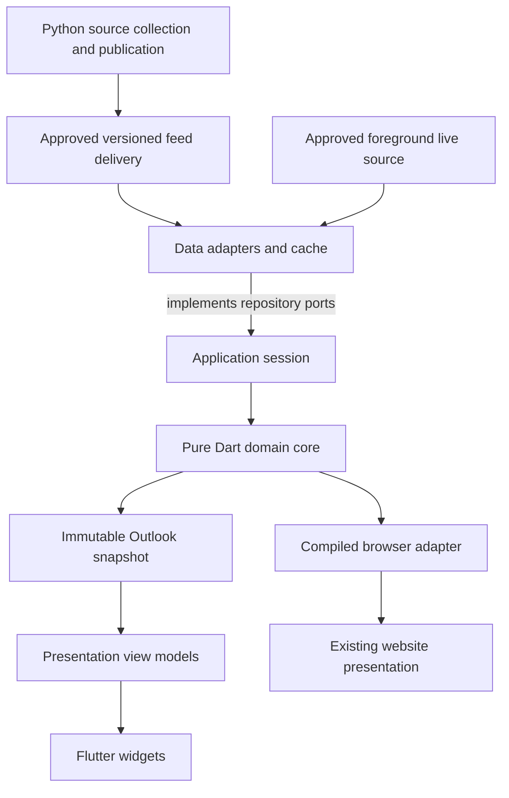

# Companion architecture

This design separates acquiring facts, deciding what those facts mean, coordinating the application, and drawing its screens. It lets a broadcast correction or ranking change reach every card and both clients without becoming a collection of unrelated UI fixes.

This is the target architecture. P0 and the local P1 producer/reader are
implemented within the limits in the [implementation plan](implementation-plan.md);
production rule migration, application services and the app remain proposed.

## Existing system and the change

The website is a Python-generated static site with JavaScript for preferences, recommendations and live updates. Python owns fixture discovery, rights mappings, broadcaster verification, base Outlook scoring and publication. Much of the visitor-specific behavior currently lives in [web/app.js](../../web/app.js). The current [schedule feed](../../schedule_data.py) contains rendered HTML rows; `schedule-context.json` is an internal, expiring build cache.

Neither format is the companion API. Add a versioned publication containing normalized facts and policy, leaving both existing formats in place during migration. Keep the static website, its indexable pages and its URLs. Flutter is the native presentation technology, not a replacement for the public site.

Publication, live transport, caching and archival choices depend on the selected data license. [Data licensing research](../data-licensing.md) is a P0 input: public JSON on Pages and direct ESPN access are proposed paths, not established permissions. A supplier that allows app display but requires protected delivery may require a backend. The layer boundaries remain useful with either delivery model.

## Layers and dependency direction

| Layer | Responsibility | Must not do |
| --- | --- | --- |
| Publisher | Acquire sources; reconcile fixture identities; verify US listings and package facts; calculate base ratings; publish complete versioned inputs | Embed a visitor's preferences or personal AI response |
| Data | HTTP, wire validation, DTO mapping, persistent cache, live transport, source health and repository implementations | Invent rights, infer live status from kickoff, choose top picks |
| Domain | Immutable models; eligibility and evidence validity; time groups; AI precedence and expiry; personalized ranking and recommendations | Import Flutter, HTTP, SQL, storage plugins, or read a global clock |
| Application | Use cases, refresh lifecycle, preference changes, repository ports, immutable session state and update ordering | Parse provider payloads or repeat domain decisions |
| Presentation | View models, localized copy, measured layout, widgets, accessible actions and navigation surfaces | Decide whether a fixture is viewable or worth recommending |

The application declares the ports it needs; data adapters implement them. This keeps orchestration testable with a fake repository without making the domain know about SQL or network failures.



These arrows describe data/use relationships. At the import level, application depends on core; data depends on core and application ports; Flutter's composition root wires application and data together. Core has no dependency on those outer layers.

### Proposed source layout

Keep the initial work in the Soccer Outlook repository so a feed change and both consumers can be tested together. P0 supplies draft contracts, the small `outlook_core` time operation, bridge adapters and contract examples. P1 adds
`companion_export.py`, `companion_contract.py`, `companion_publication.py` and
`companion_build.py`, plus pure feed validation in `outlook_data` and a local
reader CLI. The application, HTTP/cache adapters and app below remain proposed:

```text
contracts/outlook/v1/           JSON Schemas and publication examples
packages/outlook_core/         Domain models, policy and deterministic decisions
packages/outlook_application/  Use cases, ports and session state
packages/outlook_data/         Feed/live adapters, mapping and cache implementation
apps/mobile/                  Flutter composition root, view models and widgets
tool/outlook_bridge/           Browser export and publisher CLI entry points
tool/companion_feed_reader/    Independent local publication reader CLI
tests/contracts/              Producer-to-consumer fixtures and parity cases
docs/companion/rules/          Rule specifications introduced during migration
```

Use dependency checks to enforce these boundaries. Flutter plugins, platform storage factories and platform lifecycle hooks are wired in `apps/mobile`, not imported by the core or application packages. A small Provider adapter can expose immutable session slices to widgets, following the familiar Pit Dash approach. View-model builders use plain Dart values and semantic style tokens; theme-to-Flutter conversions stay in presentation.

## One owner for each decision

The target is one implementation per production rule, not merely two implementations that currently pass the same tests.

| Decision or fact | Current authority | Proposed owner and consumers |
| --- | --- | --- |
| Source identity and fixture reconciliation | Python source adapters and `build.py` | Remains publisher-owned; clients consume stable IDs and conflicts |
| Channel aliases, country and package mappings | `rights.toml`, `build.py::load_rights`, verified adapters | Remains publisher-owned; publish explicit permitted routes and evidence |
| Retaining verified listings across an outage | Python broadcast retention | Publisher publishes original verification and validity limit; core enforces the limit |
| Base Outlook components and total | `build.py`, `settings.toml` | Remains Python-owned; domain consumes total and explanation, never recalculates it |
| Automatic AI component aggregation | `story.py` | Remains Python-owned; publish total, dimensions and calibration version |
| Default lineup, league order and adjustable weights | `build.py`, `settings.toml` | Keep those authoring owners initially; export a single policy/defaults object |
| Qualified route preference and selected providers | Core `selectRoute`; publisher and browser adapters | Shared owner; temporal validity precedes intersection, full source qualification remains upstream |
| Qualified route temporal validity | Core `evaluateRouteValidity`; publisher and browser adapters | Shared retained/explicit deadlines and Eastern usual-rights end date; original age and supplied clock |
| League follow/pause/solo and common fixture eligibility | Core `projectViewerEligibility`; browser and publisher adapters | Shared owner; composed `buildOutlook` derives window membership, standalone operation accepts it as an input |
| Fixture focus and schedule placement | Core `evaluateFixtureWindow`; browser adapter and CLI/Python operation | Shared explicit-clock owner; schedule buckets and window membership remain separate from score freshness |
| Source observation freshness and full source qualification | JavaScript and publisher validation | Remaining P2 boundaries; retain source identity and surface-specific candidate rules |
| Personal/shared/automatic AI selection, expiry and final blend | JavaScript, `story_state.py` freshness checks and `build.py` shared-response checks | Core; publisher CLI and clients consume the same semantic validity decisions |
| Sports-day date, index and shifted boundaries | Core `SportsDayCalendar`; browser and publisher window helper | Shared owner implemented with explicit evaluation time and named time zone |
| Final recommendation candidates and Python static/AI windows | JavaScript and Python policy | Remaining distinct policies; fixture focus consumes the shared window owner |
| Starting carousel item, top-pick selection and headline eligibility | JavaScript | Core; selection results are shared by every presentation |
| Six-dot rounding and component explanations | JavaScript | Core returns rating result and dot count; view models supply words and formatting |
| ESPN status/result interpretation | Data `decodeEspnStatus` and `decodeFixtureStatus`; publisher and browser bridge adapters | Shared pure decoder owns normalized status and result meaning; core freshness remains separate |
| Request scheduling and lifecycle | Browser transport modules | Application coordinator; browser shell may retain its lifecycle adapter |
| Wire versions, stored keys, schema and migration versions | Several existing formats | Contract/schema owner and one storage owner per format; no widget literals |
| Text, navigation and card layout | Browser presentation | Separate browser/Flutter presentation, deliberately platform-specific |

The first P2 increment removes Python's route preference and provider-order
calculation. A persistent Dart CLI supplies those decisions to full and
lightweight builds; Python still renders HTML. The next increment also moves
league choices and common fixture eligibility into the core, including
catalog-wide calendar-editorial gating. Qualified-route validity now also runs
before intersection with an explicit clock, original observation age and an
exclusive cutoff. Fixture focus and schedule buckets now also use one supplied
clock, with original receipt facts and separate source-state observations.
Source status/result decoding now uses the pure data owner. Observation
freshness, full source qualification and the final recommendation projection
remain to migrate. CI compiles the same owner for
the browser as one content-addressed, integrity-checked script beside the page.
Visitors need no Dart installation; the additional request keeps the existing
HTML size budget and logos intact. See [first-increment evidence](p2-evidence.md)
and [viewer-eligibility evidence](p2-eligibility-evidence.md), followed by
[route-validity evidence](p2-validity-evidence.md) and
[fixture-window evidence](p2-window-evidence.md) and the
[status/result review checkpoint](p2-status-evidence.md).

The CLI does not replace Python's factual scoring or source collection. Domain decisions run identically in the CLI, compiled browser adapter and mobile app; platform shells provide data, preferences, time and user actions.

Source-format decoding and domain interpretation are separate boundaries. The
shared ESPN status/result decoder lives in a pure library within the data
package, imported by the CLI and compiled browser entry point without platform
storage. Python extracts records and retains raw evidence; shared decoder facts
govern played, void, halftime, final and normalized scores. Saved rows carry
canonical status separately from display labels. Python context bindings retain
that identity and original provider phase only while the public phase/label
still match; changed facts are decoded again. Legacy rows without a binding use
the documented conservative normalized seam. A lost original provider phase
cannot be recovered from a display label. Domain observation-freshness policy
remains a later migration.

Likewise, JSON Schema checks can run in both languages from one schema, but semantic AI lifetime checks must use the core. Inventory `story_state.py`, `build.py` and browser import/story handlers together. Keep Python's AI generation and aggregation responsibilities while replacing duplicated expiry decisions through the CLI. Batch these calls per publication or generation decision; do not spawn a process for every fixture.

### Migration boundary

First capture current answers, including unusual but intentional behavior described in the [scoring guide](../scoring.md). Extract one rule family at a time. Compare the old and new implementation on independent examples and real fixtures before switching its consumers. Remove the old production decision in the same migration stage, and record any intentional behavior change separately.

For a short migration period the old browser and shared core will coexist behind an adapter. A parity harness is useful evidence during that period; it is not the permanent ownership model. If the compiled bridge or publisher CLI is impractical, stop at P0/P2 and record a replacement architecture. Do not quietly leave independent Dart and JavaScript rules in production.

## Domain inputs and snapshot

Use explicit, immutable inputs. Conceptually:

```dart
OutlookSnapshot buildOutlook({
  required ScheduleFacts facts,
  required EditorialInputs editorial,
  required ViewerPreferences preferences,
  required OutlookPolicy policy,
  required EvaluationContext evaluation,
});
```

This is a proposed interface, not an existing API. `ScheduleFacts` already includes accepted live observations. Data adapters map validated DTOs into these domain inputs; the factory does not import wire or database models.

Important domain types include `FixtureId`, `CompetitionId`, `ServicePlanId`, `NetworkId`, `Fixture`, `BroadcastRoute`, `Evidence`, `TeamVitals`, `MatchRating`, `LeagueHeadline`, `SourceHealth`, `ViewerPreferences` and `OutlookSnapshot`. Use distinct types for missing, unknown, unconfirmed and explicitly rejected facts. A date-only fixture is not a midnight kickoff. An unknown score is not 0–0.

The snapshot exposes:

- Visible fixture IDs, eligibility results and reasons, usable network routes and viewing links.
- Resolved ratings with provenance, inputs, selected blend, missing components and dot count.
- Ordered carousel groups, its opening match, top picks and chronological schedule groups.
- Eligible headlines and per-match stories, independent of whether AI text is currently shown.
- Source ages, health judgments and the time each decision was evaluated.

Widgets read these results. They do not run a smaller eligibility check for their own card. The same `MatchPresentation` builder supplies schedule, carousel and pick-card roles; layouts may differ while information and actions agree.

### Time and identity

Pass one UTC evaluation instant and an IANA viewer time zone into the snapshot build. A shared pure Dart time-zone implementation must give the browser, CLI and app the same sports-day answers through daylight-saving transitions. The publisher's ESPN date conventions remain separate from viewer-local grouping.

No domain function calls `DateTime.now()`. The application injects a clock and schedules reevaluation when a decision can change, including AI expiry, evidence expiry, the 4 a.m. boundary and relevant live freshness thresholds. Countdown repaint frequency need not force every list to rebuild.

Snapshot equality includes schedule revision, accepted live observation revision, policy revision, editorial publication revision, personal response revision, preference revision and evaluation/time-zone inputs. Presentation caches additionally include locale, text scale, theme and layout constraints where those affect their output. A publication sequence orders updates; a snapshot identity detects equality. They are not interchangeable.

Do not reset source observation times when constructing a new snapshot. Rebuilding a model every minute cannot make an hour-old score current.

## Data lifecycle and persistence

On launch, read the last validated publication and preferences independently, evaluate them at the current time, show useful cached content, then refresh. On a first launch with no cache, show a loading state followed by an explicit empty/error state if necessary. Do not ship a sample match slate that can be mistaken for today's games.

Use a transactional SQLite cache for publication metadata, immutable feed artifacts and accepted live observations, accessed through an injected database factory. Keep preferences and personal imports in a separate versioned store, so clearing or repairing downloaded data cannot delete them. A serialized preferences record through a platform adapter is sufficient initially; imports need their own bounded record and original expiry.

The repository accepts an update only after envelope, integrity, completeness and reference checks succeed. Persist its complete active generation transactionally, then emit a session update. On disk failure, preserve the last durable generation and report the failed save; do not report an update as cached when only memory changed. A validated complete empty schedule is an update, not a transport failure.

Retain a bounded previous generation for recovery. Use explicit columns and migration versions. Test interruption before and after active-pointer updates, corruption, quota exhaustion and upgrades from each supported cache version. Content cache recovery may discard unusable downloaded content; it must not reset the lineup or silently accept expired AI.

Preference changes follow the same write-before-success rule, coalesce into one coherent emission and avoid writes for equal values. Retain the last saved state and show a recoverable error if persistence fails. Navigation is independent of repository updates; refreshing cannot close a sheet or reset a user's carousel position without the documented selection rule requiring it.

## Refreshing and live scores

The published schedule changes on the existing full and lightweight workflow cadence. Foreground clients check the publication manifest conditionally, with bounded concurrency, timeouts and backoff. HTTP success, payload publication time and source observation time are separate fields.

Preserve each accepted fixture response's original receipt through publication,
cache and overlay reuse. [LIVE-FRESHNESS-1](rules/live-response-freshness.md)
allows current-live presentation only while that in-progress response is less
than three minutes old. Reevaluate at its exact deadline and on resume; an
expired report retains its score and clock as last known and loses live-only
destinations. The pure shared owner receives an explicit clock. Browser calendar
previews do not freeze this safety clock. This response timeout does not infer
the underlying source observation time or change polling cadence.

A half-hour publication cannot provide the existing website's approximately minute-level live updates. The first release therefore needs an approved foreground live-data path, validated on both mobile platforms in P0. Direct ESPN access requires permission; a licensed alternative can use its own adapter and server-held credentials. Share the selected source parser and status reconciliation with the browser; keep HTTP and lifecycle platform-specific. It updates only identified fixtures' score/status/clock events. It cannot add broadcast rights, derive provider access or turn a replay into a live fixture.

Use the existing poll windows as the initial behavior baseline, then move their policy values to one owner. Include successful final-score catch-up after sleep. Cancel or invalidate obsolete batches with a generation token; a late response for an old fixture identity or kickoff must not overwrite the current snapshot. A newer accepted live observation survives an older aggregate publication. Corrections need explicit ordering/provenance; a “final” result is not immune to a later authoritative correction.

Stop polling when the app is hidden or paused, dispose subscriptions, and refresh on resume or restored connectivity without starting duplicate loops. An unfocused but visible window is different from a hidden app. Background execution on iOS and Android is opportunistic: this release does not promise continuous background scores or notification delivery.

If direct source access is unavailable, retain the published/cache view with a clear last-checked indicator. Do not label it as a current live feed. A hosted proxy or push system would require a separate infrastructure decision, not an implicit expansion of this plan.

## Editorial content and trust boundaries

Published and imported AI can supply ratings and commentary, not schedule truth. The core enforces fixture identity, original prompt/generation times, expiry and eligibility before using it. Publishing, downloading or recalculating a total never renews its lifetime.

Preserve the existing distinction between disabling AI text and disabling automatic AI generation. The normal text toggle hides both headlines and stories while ratings can still contribute. Personal/shared/automatic precedence and the explicit empty-headline behavior are governed by the [product specification](specification.md) and existing import contract.

Render text as text and validate external HTTPS links. No API key, owner GitHub token or service password belongs in the public feed, app bundle, logs, prompts or backups. Opening a provider link is an external navigation action; possession of a link is not proof of subscription access. The consumer app does not authenticate to broadcasters or publish shared site defaults in this release.

## Responsive presentation

Adopt Pit Dash's measured layout approach: actual available constraints, actual text metrics and explicit content priorities. Match-card roles share content models and layout measurement helpers, not unrelated widget copies.

On roomy schedule rows, stack teams and place supplemental information and right-aligned networks beside them. When measured content no longer fits, move the networks below while preserving the prominent **More** action. Coordinate heights across all reachable cards in a carousel so sliding does not move the following section. Preserve current logo contrast treatment without brightening already-bright marks.

Use stable fixture IDs as widget keys. Keep navigation and scroll state separate from fresh data. Support large text, screen readers, keyboard interaction, reduced motion and non-drag alternatives to reorder preferences. Detailed cases and acceptance criteria belong in the [specification](specification.md); UI copy and regression practices belong in [engineering](engineering.md).

## Decisions requiring evidence

| Decision | Recommended baseline | Evidence needed |
| --- | --- | --- |
| Client technology | Flutter iOS/Android, phones/tablets | P0 platform/toolchain and plugin compatibility |
| Shared rules | Pure Dart, browser adapter and publisher CLI | P0 compiled size/startup, interop, time zones and deployment spike |
| Live transport | Approved source adapter; ESPN only with permission | P0 production permission remains open despite the native transport spike; P2/P3 decoder/freshness/reconciliation and device acceptance remain required |
| Storage | Transactional snapshot cache; separate preferences/imports | P3 crash, migration and persistence tests |
| Repository | One monorepo initially | Separate-repo needs, if any, reviewed before moving consumers |
| Distribution | Pilot before public stores | P6 signing, developer accounts, device testing and explicit release authorization |

The [implementation plan](implementation-plan.md) records stage exits and alternatives when a gate fails. There is no requirement to reproduce Pit Dash's full temporal database, daemon infrastructure or historical replay interface.

The [P0 evidence](p0-evidence.md) proves a single time operation across VM,
compiled CLI and browser, plus isolated native transport and plugin use.
The [decisions and limits](p0-decisions.md) allow continued local implementation.
The browser ceiling applies to the entire eventual core and must be rechecked
as rules migrate. The bounded status decoder now has local evidence;
observation freshness/reconciliation, durable cache and physical-device
acceptance remain downstream work. Source permission gates distribution.

The [current P1 evidence](p1-continuation-evidence.md) covers the local
producer/reader boundary and fresh source/rendered reconciliation.
The publisher now reads shared status/result decisions. Python editorial
conversion and semantic lifetime checks remain temporary owners pending their
P2 migration. The Dart reader validates facts and bindings without selecting a
viewer lineup. It has no HTTP refresh or durable client installation yet.

## About this document

- Status: target architecture with P0/P1 local acceptance and bounded P2 route, calendar, eligibility, validity, fixture-window and status/result owners, October 23, 2026. P2 remains incomplete; distribution stays gated.
- Sources: current [development guide](../development.md), [schedule behavior](../schedule-data.md), [ranking behavior](../scoring.md), and Pit Dash's [architecture](https://github.com/caparomula/pit-dash/blob/865fa263062b0870b9ae71555132d4ace894dccf/README.md#architecture).
- Pit Dash places its sole data-to-domain factory inside the domain package and intentionally imports data models there. This design instead puts wire mapping in data adapters; the stricter boundary is an adaptation, not a description of Pit Dash's implementation.
- Related: [product requirements](specification.md), [data contract](data-contract.md), [engineering practices](engineering.md).
