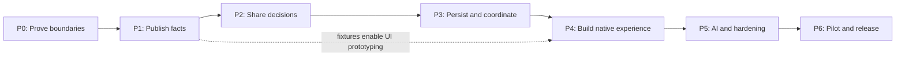

# Companion implementation plan

Build the companion in small, reviewable stages, beginning with the contracts and shared decisions that will keep it consistent with the website. Each stage below ends with working evidence, updated documentation and a clear recovery path.

The P0 technical spike and P1 local producer/reader acceptance passed on
October 20, 2026 within the scope recorded below. P0's source-permission
requirement remains unresolved, so these results do not establish production
readiness or permission to distribute. The user explicitly authorized continued
local engineering while that gate remains open.

## Current checkpoint

The [P0 evidence record](p0-evidence.md) links the runnable Dart/browser/publisher
spike, [ownership map](p0-ownership.md), [draft contracts](p0-contract.md),
[published-site comparison](p0-publication.md), [native transport findings](p0-live.md)
and [engineering decisions](p0-decisions.md). The deployed website remains unchanged.
The [current P1 evidence record](p1-continuation-evidence.md) and
[operation guide](p1-operation.md) cover the local exporter, publication writer,
independent Dart reader and fresh source/rendered reconciliation. The
[initial checkpoint](p1-evidence.md) remains as historical evidence.

- Passed: shared sports-day VM/browser/compiled-CLI parity and strict CSP;
  enforced browser size budget; 360-fixture publication comparison; draft
  contract checks; native HTTPS, real timeout/recovery, background/resume and
  plugin smoke on both dedicated simulator/emulator targets.
- Decided: OS floors, exact plugins, physical reference targets, performance
  and cache budgets, and feed-version support policy.
- Deferred with explicit scope: source permission blocks distribution;
  physical/minimum-OS runtime and release performance remain later gates.
  The transport captures preserve wire facts and unknown score freshness;
  production status decoding, stale presentation and live correction ordering
  still require P2/P3 acceptance evidence.
- Implemented locally: P1's opt-in exporter, full/lightweight build integration,
  atomic immutable publication with durable revisions, original editorial
  bindings/lifetimes, and independent Dart validation. Workflow export remains
  disabled, and no public API has been deployed.
- Passed locally: all 306 required source requests and 360 fixtures reconciled
  with the same rendered output and independent reader; bounded form-order
  evidence with explicit accuracy/freshness limits; numeric-zero preservation;
  repaired WebKit focus/provider activation; 675 Python, 25 Dart and 172 browser
  checks. The offline lightweight replay preserves original ages and artifact
  bytes while advancing the publication revision.
- Remaining P1 delivery: an authorized feed endpoint. Public JSON requires
  machine-readable distribution rights; protected delivery may require a revised
  architecture. Local technical acceptance is complete; source permission and
  publication authorization still gate distribution.
- P2 in progress: shared owners now select among qualified viewing routes,
  calculate sports-day boundaries and project league follow/pause/solo choices
  into common fixture eligibility. The publisher and browser read those Dart
  decisions; migrated copies are removed. See the [rule catalog](rules/README.md),
  [first increment](p2-evidence.md) and [eligibility increment](p2-eligibility-evidence.md).
  Qualified-route expiry also passed local acceptance on October 23; see the
  [validity evidence](p2-validity-evidence.md). Original observation deadlines
  now govern publisher and browser access, including reload, refresh and resume.
  Fixture focus and schedule placement now share one supplied clock and owner;
  see the [window evidence](p2-window-evidence.md). The bounded ESPN status/result
  decoder now serves publisher and browser consumers from one pure data owner;
  see the [status review checkpoint](p2-status-evidence.md). Full source
  qualification, observation freshness, ranking and editorial lifetime semantics
  remain later P2 work.

## Scope and sequence

The first release targets iOS and Android phones and tablets. It includes local preferences, the filtered schedule, the live/upcoming carousel, top picks, optional league headlines and match stories, details/vitals, manual AI import and useful cached operation. The website remains available and indexable.

No new account system, paid AI connection, push service, watch-history collection or always-running background updater is part of this release. See the [specification](specification.md) for product requirements, [architecture](architecture.md) for owners, [data contract](data-contract.md) for publication, and [engineering guide](engineering.md) for review standards.

The arrows indicate completion dependencies, not a requirement for one person to do every task serially. Contract fixtures, layout prototypes and documentation can proceed in parallel after interfaces stabilize. A prototype must not grow its own ranking or entitlement logic while waiting for the shared core.

## P0: Prove the architecture

**Purpose:** resolve the expensive uncertainties before a broad rewrite.

1. Resolve the [source-permission and paid-feed options](../data-licensing.md) for the intended production uses. Record authority to access and display data, public JSON delivery, cache/history retention, AI inference and artwork separately. Use the [inquiry drafts](../data-permission-requests.md); obtaining a working API key or buying an evaluation plan is not this gate's evidence. Synthetic or expressly permitted fixtures can support independent prototyping while commercial questions are unresolved.
2. Inventory current production rule owners across Python and JavaScript, including the Python default-view calculation, duplicated ESPN status/result interpretation, and AI expiry checks in `story_state.py`, `build.py` and browser handlers. Map the specification's requirement IDs to current owners, proposed owners, tests and consumers. Capture representative permitted data and browser outputs, with no personal data.
3. Pin a supported Flutter/Dart toolchain and record the Android and iOS build environments. Reuse Pit Dash's conventions where useful, but check current plugin requirements rather than inheriting its exact versions. Linux can run shared/package checks; iOS build/signing checks need macOS and Xcode.
4. Spike one pure Dart eligibility/ranking/time operation, exposed through a small JavaScript interface and a publisher CLI. Exercise identical inputs in Dart VM, compiled browser code and Python-to-CLI invocation. Test named time zones and daylight-saving boundaries. Include browser artifact size, startup overhead, CSP compatibility and static-site integration.
5. Spike an approved foreground live-data path on iOS and Android. Direct ESPN access is conditional on permission; a licensed replacement may need server-held credentials and different source IDs. Verify preservation of fixture identity, wire status and score using permitted captures and a limited live check; distinguish receipt time from unknown source freshness. Exercise real timeouts and OS pause/resume. Production status decoding, stale-data presentation and live-transition/correction ordering require separate P2/P3 evidence. Do not infer that browser CORS success guarantees every platform's access or grants reuse rights.
6. Draft the v1 JSON Schemas, representative examples, policy identifiers and compatibility decisions from the [contract](data-contract.md). Separate factual publication from personalized views, and limit delivery/retention to the agreed scope.
7. Record decisions, measurements and any changed assumptions in these documents. Decide minimum OS versions, reference devices, size/startup budgets, cache limits and supported client-version policy before proceeding beyond the spike.

**Exit evidence:** the selected data source's permitted production uses are documented; a small reproducible demo runs the same input through all three rule consumers; browser overhead is measured against the existing page; native live transport is proven or a limitation is explicitly resolved; the schemas and ownership map are reviewed. An unexplained parity difference, unproven live path or unresolved permission for the planned publication is not a pass.

**October 20 technical disposition, reconciled October 23:** the bounded
technical portion is satisfied by the linked evidence. The combined P0 exit
remains open until the selected source's permitted production uses are
documented. The user's instruction to continue local engineering does not grant
source access, reuse or distribution rights.
Native captures include scheduled/final wire records, not an observed
live-to-final sequence. That limit does not certify the later production
decoder, freshness rules or reconciliation; those must pass P2/P3 before live
behavior is adopted. Physical-device and minimum-OS testing still precede pilot
distribution.

**If a gate fails:** revise the architecture before implementing the dependent layer. Separate Dart and JavaScript implementations are controlled duplication, not the promised one-owner design. A hosted live proxy would change operating scope. Neither fallback should appear silently in later work.

**Delivery:** architecture decision records, spike evidence, initial schema and rule examples. The current site remains unchanged.

## P1: Publish a stable feed

**Purpose:** make the existing pipeline a reliable producer for an independent client.

1. Add the versioned exporter alongside the existing HTML and cache outputs within the P0 license scope. Export canonical fixture identities, teams, competitions, status, venue, form, networks, service-plan routes, evidence, source health, base score components, policy/defaults and editorial references. If public JSON/history is not permitted, revise the delivery and storage architecture before publishing; a hidden URL is not a substitute for permission.
2. Publish a manifest and immutable, integrity-checked artifacts. Allocate publication sequence numbers from durable published state; serialize writers and keep the existing superseded-main checks. Do not renew source ages or AI lifetimes when republishing.
3. Integrate both full and lightweight workflows. A coherent publication must survive incomplete upstream fixture data, optional editorial failure and simultaneous builds. Preserve the existing website outputs and historical metric archive.
4. Define the requested/observed source scope and local-time boundary coverage explicitly. Compare the feed to the actual rendered site and source diagnostics, including fixtures that fail the owner's default filters.
5. Add production-exporter fixtures and schema checks. Include complete empty schedules, partial failures, missing scores, unknown kickoff times, alternate channels, package exclusions, replays and unknown fields.
6. Document feed operation, retention, support lifetime and rollback in the maintenance guide.

**Exit evidence:** both build paths publish a coherent v1 feed; an independent parser accepts real exporter output; every fixture/route/reference reconciles with source evidence; injected build failures leave the prior publication usable. Existing Python and affected browser checks pass.

**Delivery:** feed URL and schema, sample captured publication, coverage report and producer tests. No app or website reader switches yet.

**October 20 local acceptance:** the producer and independent reader are
implemented, including complete-empty and incomplete-source handling, preserved
source ages, optional editorial isolation, concurrent writers, durable sequence
reservation, retention and rollback. Both build paths are tested locally;
workflow export remains disabled and remote workflows unexecuted. The fresh
306-request collection reconciles 360 fixtures across source, rendered output
and the independent reader. Form order now has bounded independent evidence,
and the affected Chromium/WebKit gates pass. See the
[current P1 evidence](p1-continuation-evidence.md) for results and limitations.
The local technical exit is satisfied. Source permission and publication
authorization remain required before the feed-URL delivery; this is not a
shipped compatibility promise. P2 can proceed locally under the existing
authorization to continue engineering while distribution stays gated.

**Recovery:** disable the new export while retaining the old website artifacts. Once clients use v1, use a new publication sequence pointing to validated prior content for rollback, not a rewound counter.

## P2: Establish the shared domain

**Purpose:** make one set of decisions serve the website and native client.

1. Create the pure domain package and boundary checks. Add immutable inputs and `buildOutlook`, with supplied time and named time zone. Keep factual Outlook calculation and automatic AI component aggregation in Python.
2. Move behavior in coherent families: viewer eligibility and valid viewing routes; sports-day/status handling; rating provenance, blending and dot rounding; carousel/top-pick selection; headline/story eligibility and expiry.
3. For each family, write its stable rule specification with independently authored examples before replacing its consumers. Examples must cover both the intended result and why tempting alternatives are wrong.
4. Run old and new answers over real fixture captures and generated boundary cases. Keep the original results as migration evidence, not as the only correctness oracle. Document any existing defect discovered; fix it separately from an otherwise behavior-preserving extraction.
5. Integrate the browser adapter and publisher CLI. Replace the affected JavaScript decisions, Python default-view decisions, semantic AI expiry checks and duplicated ESPN status/result decoding with calls to their shared owners. Keep wire-shape validation schema-driven. Preserve static HTML, accessible fallback content, URL behavior, saved browser preferences and the browser's current live-update path.
6. Add rule-owner and consumer checks. Start executable examples with eligibility and sports days, then cover the migrated rating and editorial rules. Add review fingerprints only when the review/stamping workflow is in place.

**Exit evidence:** native/compiled/CLI results agree on the recorded corpus and independent examples; the website passes affected Chromium/WebKit checks; production duplicates for migrated decisions are removed; each rule has a documented owner, consumers and tests. Scoring calibration, package boundaries and AI expiry remain intact.

**Delivery:** shared core, browser/CLI adapters and rule catalog. A developer can inspect a decision without opening a widget.

**October 20 first increment:** `WATCH-ROUTES-1` and the `TIME-1` calendar are
implemented in the pure core, with immutable inputs and a partial `buildOutlook`
snapshot. Browser batches and a bounded persistent publisher CLI use those
owners. `build.evaluate`, provider ordering, browser calendar helpers and
`story_state.window_end` now delegate instead of repeating the migrated rules.
The [evidence record](p2-evidence.md) distinguishes independent examples,
captured legacy comparisons, actual generated-page checks and remaining gaps.
The subsequent increment below extends this snapshot; neither increment implies
a native product or distribution.

**October 20 viewer-eligibility increment:** `VIEWER-ELIGIBILITY-1` owns explicit
league choices over defaults, pauses, valid temporary solo selection, strip
membership and the common route/league filter. The browser's schedule, carousel,
match editorial, calendar-only editorial and league-only consumers read the
appropriate shared decisions. Python's default-view and filter-pill decisions
also delegate. At this checkpoint, `buildOutlook` composed routes, calendar
labels and eligibility with window classification as an explicit input. The
October 23 window increment below replaces that input with shared evaluation.
See [the evidence record](p2-eligibility-evidence.md) for independent examples,
frozen browser comparisons, actual page transitions and build replays.

**October 23 route-validity acceptance:** `WATCH-VALIDITY-1` owns retained
observation deadlines, explicit route expiry and inclusive Eastern usual-rights
end dates before provider selection. Publisher outputs and the browser supply
original evidence and an explicit clock. Access, strip/solo state, match editorial,
provider links and prompt channels update at a cutoff and on resume without
renewing the observation. Reload and schedule refresh preserve the same deadline.
The exclusive six-hour endpoint and the actual output clock's precedence over a
historical `--date` are documented behavior changes. Duplicate and malformed
retained evidence now preserve conservative deadlines through source outages;
independent fresh routes remain available. See the [rule](rules/route-validity.md)
and [acceptance evidence](p2-validity-evidence.md) for source-bound core,
Python, Chromium/WebKit, adversarial review and full/lightweight replay results.

**October 23 fixture-window acceptance:** `TIME-WINDOW-1` owns fixture focus,
schedule buckets and schedule-window membership. The browser batches explicit
clock, zone, kickoff, normalized source state, confirmed-time and original
receipt facts; `buildOutlook` computes the same window before eligibility. The
versioned CLI operation and Python adapter expose the same decision. The
extraction preserves 453 frozen legacy answers and records three cases corrected
by two clock changes: receipt age uses the supplied clock, and future receipts
cannot count as recent. The [rule](rules/fixture-windows.md) and
[acceptance evidence](p2-window-evidence.md) distinguish placement from score
status and source-observation freshness. Existing lifecycle triggers remain;
there is no new dedicated deadline timer. Independent examples, four-target
parity, generated-page transitions and full/lightweight replay pass locally.

**October 23 status/result review checkpoint:** `STATUS-ESPN-1` supplies a
bounded pure data decoder through the versioned CLI and browser bridge. Raw
ESPN observations and saved normalized rows share status, played/final/void and
score decisions. Static HTML, live updates, schedule replacement, feed export,
discovery and metrics consume those facts. Canonical status survives context
serialization without reinterpreting display clocks as identity. Unknown and
void records cannot invent a result, scorer list or live-only link. The
[rule](rules/espn-status.md) and [evidence](p2-status-evidence.md) separate 360
preserved captured answers from nine declared legacy corrections and independent
boundary examples. This is a local code-review checkpoint, not full TIME-2 or
P2 acceptance.

P2 remains incomplete: source-observation freshness, full source qualification,
ranking, carousel/pick selection and editorial lifetimes still need their own
migrations. Python static grouping and AI windows
retain their distinct policies. P3 persistence and the native product remain
later work, with distribution gated.

**Recovery:** retain the pre-migration website release as a deployable rollback artifact. Do not keep competing decision implementations as a permanent runtime fallback. A rollback restores a coherent code-and-policy release.

## P3: Build data and application services

**Purpose:** provide a trustworthy session before building the whole interface.

1. Implement feed validation, DTO mapping, application repository ports and a transactional snapshot cache. Implement separate versioned persistence for preferences and personal AI imports.
2. Install updates atomically, persist before success notification, and retain a bounded previous valid generation. Handle unsupported schema/policy, missing artifacts, corrupt storage, quota failure and complete authoritative empty data.
3. Add the approved foreground live adapter and shared parser/reconciliation. Preserve newer accepted live observations through schedule refresh; reject obsolete identity/kickoff batches; allow later authoritative corrections. Keep licensed API secrets on a server when required; do not embed them in public JavaScript or the mobile binary.
4. Implement a session with injected clock, explicit snapshot identity, single-flight refresh, bounded concurrency/backoff, no-op detection and pause/resume/dispose handling.
5. Keep navigation and carousel browsing state separate. Provide pure view-model builders and small observable slices so one clock update does not rebuild every screen.
6. Build a minimal developer screen showing one filtered match, freshness and a saved preference. Reopen it offline to prove the entire production path before expanding the UI.

**Exit evidence:** cold start from cache, clean first start, offline restart, crash during update, preference write failure, rapid filter changes, AI expiry while offline and stale live responses all produce the specified states. Tests prove both required updates and intentional non-updates, including repository-to-visible-widget propagation.

**Delivery:** a usable vertical slice with persistent state and live/refresh diagnostics.

**Recovery:** unusable downloaded cache can be rebuilt; preferences/imports remain independently recoverable. Failed migrations never silently reset the lineup.

## P4: Build the native viewing experience

**Purpose:** reproduce the useful information and interactions with layouts suited to the available space.

1. Implement the shared match presentation model and card roles: leading carousel, top picks and schedule row. Include consistent team form, score, venue, networks, rating action, vitals and **More**.
2. Add schedule groups, sticky day headings and carousel follow/browse behavior. Preserve selected fixture identity across refreshes; apply documented fallback when it disappears or finishes.
3. Implement the settings tabs and enabled/disabled league/service areas, persistent ordering, clear/select/reset actions and accessible alternatives to dragging. Use published defaults instead of a second hardcoded list.
4. Implement team and league vitals, match story/link sheets, rating breakdown and external viewing/calendar actions. Use one canonical data model for each sheet and card.
5. Measure layouts with actual constraints and text. Test short/long names, many networks, missing badges, different form lengths, large text, landscape, split-screen/tablet layouts and equal carousel heights.
6. Exercise VoiceOver/TalkBack, focus order, keyboard navigation, contrast, reduced motion and non-color state cues. Keep essential names, status and access information readable without forcing a hover gesture.

**Exit evidence:** the acceptance scenarios in the [specification](specification.md) work on representative iPhone/iPad and Android phone/tablet configurations, with real-device checks for gestures and accessibility. Screenshots/goldens supplement semantic and geometry assertions; they do not replace interaction tests.

**Delivery:** feature-complete viewing and preference flows, with AI content stubbed only by validated fixtures until P5.

**Recovery:** incremental internal builds; no public-store distribution at this stage.

## P5: Complete editorial support and harden

**Purpose:** finish first-release behavior and prove it survives real source and device conditions.

1. Consume automatic and shared editorial artifacts with correct precedence, eligibility, provenance and original expiry. Honor the text-off default for both headlines and stories without changing rating behavior.
2. Implement manual prompt generation and response import, including preference text and imported-rating influence. Share the validated response semantics with the website, preserve original timestamps and leave a previous valid import intact on rejection. Support the response formats promised in the [specification](specification.md).
3. Add the equal-height headline carousel and story-in-**More** presentation. Keep expired/unavailable text absent without fabricated filler or a misleading generic headline.
4. Replay captured fixtures covering provider/package mistakes, delayed broadcasts, replays, source outages, postponed fixtures, live-to-final transitions, daylight-saving boundaries and midnight/4 a.m. transitions.
5. Test app upgrades, cache and preference migrations, links and return-from-provider behavior, low storage, interrupted downloads, low connectivity and concurrent refresh/import changes.
6. Measure startup, parsing, ranking, scrolling, memory/cache growth and foreground request volume on the P0 reference devices. Check that diagnostics redact prompts, personal preferences, tokens and private inputs.
7. Update user help, the maintenance runbook, supported-version policy and the requirement-to-test index. Review the implementation against the rule owners, not just screenshots.

**Exit evidence:** all first-release requirement IDs have passing automated or recorded manual evidence; affected Python, Dart, Flutter and browser suites pass; no unresolved defect misstates entitlement, live freshness, score provenance or persistence. Performance meets the budgets recorded in P0.

**Delivery:** a release candidate and concise evidence report. The app still does not call a user's paid AI service or publish shared defaults.

## P6: Pilot and distribute

**Purpose:** validate operation before inviting a wider audience.

1. Confirm package/bundle identifiers, signing ownership, developer accounts, supported OS versions and intended distribution channels. These are release prerequisites, not reasons to block earlier development.
2. Build reproducibly from an exact reviewed commit, with pinned dependencies, production configuration and no development secrets. Record checksums, build versions and matching feed/policy compatibility.
3. Run an authorized limited TestFlight/Android pilot through a representative busy match day and a quiet day. Verify stale-data states, offline reopening, service access labels, current live observations and empty schedules.
4. Review platform privacy declarations, external-link behavior, third-party asset attribution and source terms. No visitor analytics or personal viewing history is added merely to monitor the pilot.
5. Prepare store descriptions, screenshots, support instructions, release notes and the production incident/rollback procedure. Review these as a concrete release package before requesting distribution authorization.
6. Release only after the pilot defects are resolved and distribution is explicitly authorized. Continue publishing the supported feed versions for installed clients.

**Exit evidence:** signed pilot builds work on physical devices; release artifacts and compatibility have been verified; user/support documentation matches the implementation; distribution authorization is recorded.

**Delivery:** the companion release and a repeatable release process.

**Recovery:** withdraw or replace a bad app release through the chosen channel, publish a compatible corrected feed and preserve last-good client data. A website rollback must not silently remove a feed still needed by installed apps.

## Acceptance work that spans stages

Use the specification's IDs to maintain a requirements-to-owner-to-test index. The following risks deserve explicit evidence rather than a generic “tests pass” entry.

| Risk | Required proof | Stage |
| --- | --- | --- |
| A network implies the wrong package | US/country, plan, replay and unknown-route fixtures; positive and negative service selections | P1–P3 |
| The website and app disagree | Same input/policy/time/preferences through VM, browser and CLI; independent examples | P0, P2 |
| Old data appears newly verified | 304, republish, retained evidence and score refresh retain original ages | P1, P3, P5 |
| An update deletes useful matches | Partial failure retains last-good; complete empty publication removes matches | P1, P3 |
| An old response overwrites a new fixture | Out-of-order batches, changed kickoff/identity, newer live delta and explicit corrections | P3, P5 |
| Hidden or expired AI still affects the wrong surface | Text toggle versus ratings; provenance; original expiry; precedence and empty-headline cases | P2, P5 |
| A late game moves to the wrong day | UTC/Eastern/viewer-local differences, DST and 4 a.m. boundaries | P0, P2, P5 |
| Preferences appear saved but disappear | Reopen, no-op writes, write failures, migration and cache recovery | P3, P5 |
| Cards jump or truncate essential facts | All reachable carousel states, real text metrics, large text and narrow/wide layouts | P4 |
| New features quietly change old behavior | Browser regression evidence, rule changes distinguished from extraction, documented release deltas | P2–P6 |

## Work to defer

Home-screen widgets, reminders, push notifications, background score delivery, account synchronization, provider sign-in, direct AI subscription connections and native shared-default publishing need their own specifications and platform/security decisions. They should reuse the same domain results if introduced.

A full temporal database, developer replay UI and independent source-collection daemon are also deferred. Bounded recordings, deterministic replay tests and a persistent last-good snapshot provide the initial diagnostic value without replicating Pit Dash's whole operating environment.

Do not set calendar dates from this document alone. Use the P0/P1 measurements
to estimate the remaining stages, then schedule reviewed increments. The next
local work is review of P2's bounded shared ESPN status/result decoder, followed by
source-observation freshness, remaining source qualification, ranking, surface
selection and editorial migration. Screens must
consume the contracts and shared decisions.

## About this document

- Status: reconciled with upstream October 23, 2026. P0/P1 local technical acceptance passed; P0 production permission remains open. P2 route/calendar, viewer-eligibility, route-validity and fixture-window checkpoints passed locally; the bounded status/result decoder is ready for code review. Remaining P2 families and P3–P6 are pending; feed delivery and distribution remain gated.
- Baseline: [planning overview](README.md).
- Process references: [Pit Dash engineering guidance](https://github.com/caparomula/pit-dash/blob/865fa263062b0870b9ae71555132d4ace894dccf/AGENTS.md) and the [adoption matrix](engineering.md).
- Every stage updates its specification, architecture or runbook when behavior changes. Implementation progress and outstanding gates are recorded above and in the stage evidence.
