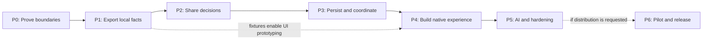

# Companion implementation plan

Build the companion in small, reviewable stages, beginning with the contracts and shared decisions that will keep it consistent with the website. Each stage below ends with working evidence, updated documentation and a clear recovery path.

This is a proposed plan. Writing it does not implement the app or authorize distribution.

**Current scope, October 23, 2026:** build the companion for the owner's personal use. Data-permission inquiries and paid-feed selection do not block P0 or local development. P1 produces a local/private feed; it does not add a public endpoint. P0–P5 lead to a usable personal build. P6 is optional future distribution work.

## Scope and sequence

The first release targets iOS and Android phones and tablets. It includes local preferences, the filtered schedule, the live/upcoming carousel, top picks, optional league headlines and match stories, details/vitals, manual AI import and useful cached operation. The website remains available and indexable.

No new account system, paid AI connection, push service, watch-history collection or always-running background updater is part of this release. See the [specification](specification.md) for product requirements, [architecture](architecture.md) for owners, [data contract](data-contract.md) for publication, and [engineering guide](engineering.md) for review standards.

The arrows indicate completion dependencies, not a requirement for one person to do every task serially. Contract fixtures, layout prototypes and documentation can proceed in parallel after interfaces stabilize. A prototype must not grow its own ranking or entitlement logic while waiting for the shared core.

## P0: Prove the architecture

**Purpose:** resolve the expensive uncertainties before a broad rewrite.

1. Define the personal development setup: local feed export, device access to that feed and replaceable source adapters. Start from the existing source pipeline and deterministic fixtures. Keep the [source-permission and paid-feed research](../data-licensing.md) as reference for later supplier or distribution decisions, outside this stage's exit criteria.
2. Inventory current production rule owners across Python and JavaScript, including the Python default-view calculation, duplicated ESPN status/result interpretation, and AI expiry checks in `story_state.py`, `build.py` and browser handlers. Map the specification's requirement IDs to current owners, proposed owners, tests and consumers. Capture representative data and browser outputs locally, with no personal data.
3. Pin a supported Flutter/Dart toolchain and record the Android and iOS build environments. Reuse Pit Dash's conventions where useful, but check current plugin requirements rather than inheriting its exact versions. Linux can run shared/package checks; iOS build/signing checks need macOS and Xcode.
4. Spike one pure Dart eligibility/ranking/time operation, exposed through a small JavaScript interface and a publisher CLI. Exercise identical inputs in Dart VM, compiled browser code and Python-to-CLI invocation. Test named time zones and daylight-saving boundaries. Include browser artifact size, startup overhead, CSP compatibility and static-site integration.
5. Spike the current ESPN foreground live-data path on iOS and Android behind a replaceable adapter. Verify fixture identity, status, score, stale data, timeouts and resume behavior using local captures and a limited live check. Browser connectivity does not prove native transport behavior. Record platform limitations explicitly; a future supplier may need server-held credentials and different source IDs.
6. Draft the v1 JSON Schemas, representative examples, policy identifiers and compatibility decisions from the [contract](data-contract.md). Separate factual publication from personalized views, and document local delivery and bounded retention.
7. Record decisions, measurements and any changed assumptions in these documents. Decide minimum OS versions, reference devices, size/startup budgets, cache limits and supported client-version policy before proceeding beyond the spike.

**Exit evidence:** a small reproducible demo runs the same input through all three rule consumers; browser overhead is measured against the existing page; native live transport is proven or a limitation is explicitly resolved; the schemas, local delivery plan and ownership map are reviewed. Unexplained parity differences and unproven live behavior remain technical blockers. Permission inquiries and supplier quotes are not exit requirements.

**If a gate fails:** revise the architecture before implementing the dependent layer. Separate Dart and JavaScript implementations are controlled duplication, not the promised one-owner design. A hosted live proxy would change operating scope. Neither fallback should appear silently in later work.

**Delivery:** architecture decision records, spike evidence, initial schema and rule examples. The current site remains unchanged.

## P1: Build a stable local feed

**Purpose:** make the existing pipeline a reliable producer for an independent client.

1. Add an opt-in versioned exporter alongside the existing HTML and cache outputs, writing to a local/private output directory. Export canonical fixture identities, teams, competitions, status, venue, form, networks, service-plan routes, evidence, source health, base score components, policy/defaults and editorial references. Keep companion artifacts out of the public Pages deployment and repository history.
2. Write a manifest and immutable, integrity-checked artifacts, then atomically activate the complete generation. Allocate publication sequence numbers from durable local state and serialize writers. Do not renew source ages or AI lifetimes when exporting again.
3. Exercise both full and lightweight build paths locally. A coherent publication must survive incomplete upstream fixture data, optional editorial failure and simultaneous builds. Preserve the existing public website outputs, deployment checks and historical metric archive.
4. Define the requested/observed source scope and local-time boundary coverage explicitly. Compare the feed to the actual rendered site and source diagnostics, including fixtures that fail the owner's default filters.
5. Add production-exporter fixtures and schema checks. Include complete empty schedules, partial failures, missing scores, unknown kickoff times, alternate channels, package exclusions, replays and unknown fields.
6. Document feed operation, retention, support lifetime and rollback in the maintenance guide.

**Exit evidence:** both build paths produce a coherent local v1 feed; an independent parser accepts real exporter output; every fixture/route/reference reconciles with source evidence; injected build failures leave the prior publication usable. Existing Python and affected browser checks pass.

**Delivery:** local feed directory and schema, a documented private device-access method, sample captured publication, coverage report and producer tests. No app or website reader switches yet.

**Recovery:** disable the new export while retaining the old website artifacts. Once clients use v1, use a new publication sequence pointing to validated prior content for rollback, not a rewound counter.

## P2: Establish the shared domain

**Purpose:** make one set of decisions serve the website and native client.

Prove the website integration in local development builds. Deploying the browser migration to the public site is separate from making the personal companion usable; keep the local integration coherent so eventual deployment does not introduce competing rule owners.

1. Create the pure domain package and boundary checks. Add immutable inputs and `buildOutlook`, with supplied time and named time zone. Keep factual Outlook calculation and automatic AI component aggregation in Python.
2. Move behavior in coherent families: viewer eligibility and valid viewing routes; sports-day/status handling; rating provenance, blending and dot rounding; carousel/top-pick selection; headline/story eligibility and expiry.
3. For each family, write its stable rule specification with independently authored examples before replacing its consumers. Examples must cover both the intended result and why tempting alternatives are wrong.
4. Run old and new answers over real fixture captures and generated boundary cases. Keep the original results as migration evidence, not as the only correctness oracle. Document any existing defect discovered; fix it separately from an otherwise behavior-preserving extraction.
5. Integrate the browser adapter and publisher CLI. Replace the affected JavaScript decisions, Python default-view decisions, semantic AI expiry checks and duplicated ESPN status/result decoding with calls to their shared owners. Keep wire-shape validation schema-driven. Preserve static HTML, accessible fallback content, URL behavior, saved browser preferences and the browser's current live-update path.
6. Add rule-owner and consumer checks. Start executable examples with eligibility and sports days, then cover the migrated rating and editorial rules. Add review fingerprints only when the review/stamping workflow is in place.

**Exit evidence:** native/compiled/CLI results agree on the recorded corpus and independent examples; the locally integrated website passes affected Chromium/WebKit checks; duplicates for migrated decisions are removed from that integration; each rule has a documented owner, consumers and tests. Scoring calibration, package boundaries and AI expiry remain intact.

**Delivery:** shared core, browser/CLI adapters and rule catalog. A developer can inspect a decision without opening a widget.

**Recovery:** retain the pre-migration website release as a deployable rollback artifact. Do not keep competing decision implementations as a permanent runtime fallback. A rollback restores a coherent code-and-policy release.

## P3: Build data and application services

**Purpose:** provide a trustworthy session before building the whole interface.

1. Implement feed validation, DTO mapping, application repository ports and a transactional snapshot cache. Implement separate versioned persistence for preferences and personal AI imports.
2. Install updates atomically, persist before success notification, and retain a bounded previous valid generation. Handle unsupported schema/policy, missing artifacts, corrupt storage, quota failure and complete authoritative empty data.
3. Add the foreground live adapter proven in P0 and shared parser/reconciliation. Preserve newer accepted live observations through schedule refresh; reject obsolete identity/kickoff batches; allow later authoritative corrections. If a later supplier requires server-held API secrets, do not embed them in public JavaScript or the mobile binary.
4. Implement a session with injected clock, explicit snapshot identity, single-flight refresh, bounded concurrency/backoff, no-op detection and pause/resume/dispose handling.
5. Keep navigation and carousel browsing state separate. Provide pure view-model builders and small observable slices so one clock update does not rebuild every screen.
6. Build a minimal developer screen showing one filtered match, freshness and a saved preference. Reopen it offline to prove the entire production path before expanding the UI.

**Exit evidence:** cold start from cache, clean first start, offline restart, crash during update, preference write failure, rapid filter changes, AI expiry while offline and stale live responses all produce the specified states. Tests prove both required updates and intentional non-updates, including repository-to-visible-widget propagation.

**Delivery:** a usable vertical slice with persistent state and live/refresh diagnostics.

**Recovery:** unusable downloaded cache can be rebuilt; preferences/imports remain independently recoverable. Failed migrations never silently reset the lineup.

## P4: Build the native viewing experience

**Purpose:** reproduce the useful information and interactions with layouts suited to the available space.

1. Implement the shared match presentation model and card roles: leading carousel, top picks and schedule row. Include consistent team form, score, venue, networks, rating action, vitals and **More**.
2. Add schedule groups, sticky day headings and carousel follow/browse behavior. Preserve selected fixture identity across refreshes; apply documented fallback when it disappears or finishes.
3. Implement the settings tabs and enabled/disabled league/service areas, persistent ordering, clear/select/reset actions and accessible alternatives to dragging. Use published defaults instead of a second hardcoded list.
4. Implement team and league vitals, match story/link sheets, rating breakdown and external viewing/calendar actions. Use one canonical data model for each sheet and card.
5. Measure layouts with actual constraints and text. Test short/long names, many networks, missing badges, different form lengths, large text, landscape, split-screen/tablet layouts and equal carousel heights.
6. Exercise VoiceOver/TalkBack, focus order, keyboard navigation, contrast, reduced motion and non-color state cues. Keep essential names, status and access information readable without forcing a hover gesture.

**Exit evidence:** the acceptance scenarios in the [specification](specification.md) work on representative iPhone/iPad and Android phone/tablet configurations, with real-device checks for gestures and accessibility. Screenshots/goldens supplement semantic and geometry assertions; they do not replace interaction tests.

**Delivery:** feature-complete viewing and preference flows, with AI content stubbed only by validated fixtures until P5.

**Recovery:** incremental internal builds; no public-store distribution at this stage.

## P5: Complete editorial support and harden

**Purpose:** finish first-release behavior and prove it survives real source and device conditions.

1. Consume automatic and shared editorial artifacts with correct precedence, eligibility, provenance and original expiry. Honor the text-off default for both headlines and stories without changing rating behavior.
2. Implement manual prompt generation and response import, including preference text and imported-rating influence. Share the validated response semantics with the website, preserve original timestamps and leave a previous valid import intact on rejection. Support the response formats promised in the [specification](specification.md).
3. Add the equal-height headline carousel and story-in-**More** presentation. Keep expired/unavailable text absent without fabricated filler or a misleading generic headline.
4. Replay captured fixtures covering provider/package mistakes, delayed broadcasts, replays, source outages, postponed fixtures, live-to-final transitions, daylight-saving boundaries and midnight/4 a.m. transitions.
5. Test app upgrades, cache and preference migrations, links and return-from-provider behavior, low storage, interrupted downloads, low connectivity and concurrent refresh/import changes.
6. Measure startup, parsing, ranking, scrolling, memory/cache growth and foreground request volume on the P0 reference devices. Check that diagnostics redact prompts, personal preferences, tokens and private inputs.
7. Update user help, the maintenance runbook, supported-version policy and the requirement-to-test index. Review the implementation against the rule owners, not just screenshots.

**Exit evidence:** all first-release requirement IDs have passing automated or recorded manual evidence; affected Python, Dart, Flutter and browser suites pass; no unresolved defect misstates entitlement, live freshness, score provenance or persistence. Performance meets the budgets recorded in P0.

**Delivery:** a usable personal build and concise evidence report, exercised on the owner's device through a busy match day, a quiet day and offline reopening. The app still does not call a user's paid AI service or publish shared defaults. Public distribution is not needed to complete this milestone.

## P6: Optional pilot and distribution

**Purpose:** validate operation before inviting a wider audience.

This stage is deferred unless the owner later requests sharing or public distribution. Before adding a public feed or distributing the app, revisit the [licensing research](../data-licensing.md), intended delivery model, retention and artwork scope. These decisions do not hold up P0–P5.

1. Confirm package/bundle identifiers, signing ownership, developer accounts, supported OS versions and intended distribution channels. These are release prerequisites, not reasons to block earlier development.
2. Build reproducibly from an exact reviewed commit, with pinned dependencies, production configuration and no development secrets. Record checksums, build versions and matching feed/policy compatibility.
3. Run an authorized limited TestFlight/Android pilot through a representative busy match day and a quiet day. Verify stale-data states, offline reopening, service access labels, current live observations and empty schedules.
4. Review platform privacy declarations, external-link behavior, third-party asset attribution and source terms. No visitor analytics or personal viewing history is added merely to monitor the pilot.
5. Prepare store descriptions, screenshots, support instructions, release notes and the production incident/rollback procedure. Review these as a concrete release package before requesting distribution authorization.
6. Release only after the pilot defects are resolved and distribution is explicitly authorized. Continue publishing the supported feed versions for installed clients.

**Exit evidence:** signed pilot builds work on physical devices; release artifacts and compatibility have been verified; user/support documentation matches the implementation; distribution authorization is recorded.

**Delivery:** the companion release and a repeatable release process.

**Recovery:** withdraw or replace a bad app release through the chosen channel, publish a compatible corrected feed and preserve last-good client data. A website rollback must not silently remove a feed still needed by installed apps.

## Acceptance work that spans stages

Use the specification's IDs to maintain a requirements-to-owner-to-test index. The following risks deserve explicit evidence rather than a generic “tests pass” entry.

| Risk | Required proof | Stage |
| --- | --- | --- |
| A network implies the wrong package | US/country, plan, replay and unknown-route fixtures; positive and negative service selections | P1–P3 |
| The website and app disagree | Same input/policy/time/preferences through VM, browser and CLI; independent examples | P0, P2 |
| Old data appears newly verified | 304, republish, retained evidence and score refresh retain original ages | P1, P3, P5 |
| An update deletes useful matches | Partial failure retains last-good; complete empty publication removes matches | P1, P3 |
| An old response overwrites a new fixture | Out-of-order batches, changed kickoff/identity, newer live delta and explicit corrections | P3, P5 |
| Hidden or expired AI still affects the wrong surface | Text toggle versus ratings; provenance; original expiry; precedence and empty-headline cases | P2, P5 |
| A late game moves to the wrong day | UTC/Eastern/viewer-local differences, DST and 4 a.m. boundaries | P0, P2, P5 |
| Preferences appear saved but disappear | Reopen, no-op writes, write failures, migration and cache recovery | P3, P5 |
| Cards jump or truncate essential facts | All reachable carousel states, real text metrics, large text and narrow/wide layouts | P4 |
| New features quietly change old behavior | Browser regression evidence, rule changes distinguished from extraction, documented release deltas | P2–P6 |

## Work to defer

Home-screen widgets, reminders, push notifications, background score delivery, account synchronization, provider sign-in, direct AI subscription connections and native shared-default publishing need their own specifications and platform/security decisions. They should reuse the same domain results if introduced.

A full temporal database, developer replay UI and independent source-collection daemon are also deferred. Bounded recordings, deterministic replay tests and a persistent last-good snapshot provide the initial diagnostic value without replicating Pit Dash's whole operating environment.

Do not set calendar dates from this document alone. Estimate P1–P5 after P0 identifies the browser migration and native transport costs; then schedule reviewed increments. Estimate P6 only if distribution becomes a goal. The immediate implementation task is the P0 spike and ownership/contract work, not building screens against unstable HTML.

## About this document

- Status: proposed, October 20, 2026.
- Baseline: [planning overview](README.md).
- Process references: [Pit Dash engineering guidance](https://github.com/caparomula/pit-dash/blob/865fa263062b0870b9ae71555132d4ace894dccf/AGENTS.md) and the [adoption matrix](engineering.md).
- Every stage updates its specification, architecture or runbook when behavior changes. Document-only completion is sufficient for this planning task; it is not evidence that an implementation stage passed.
